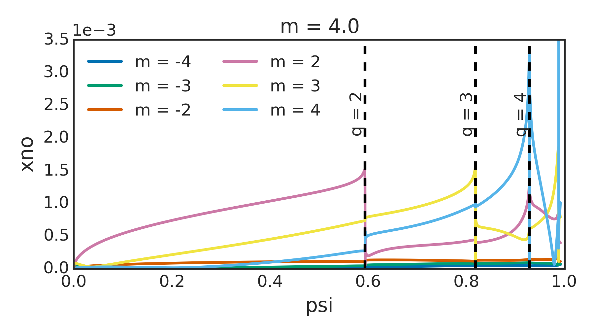
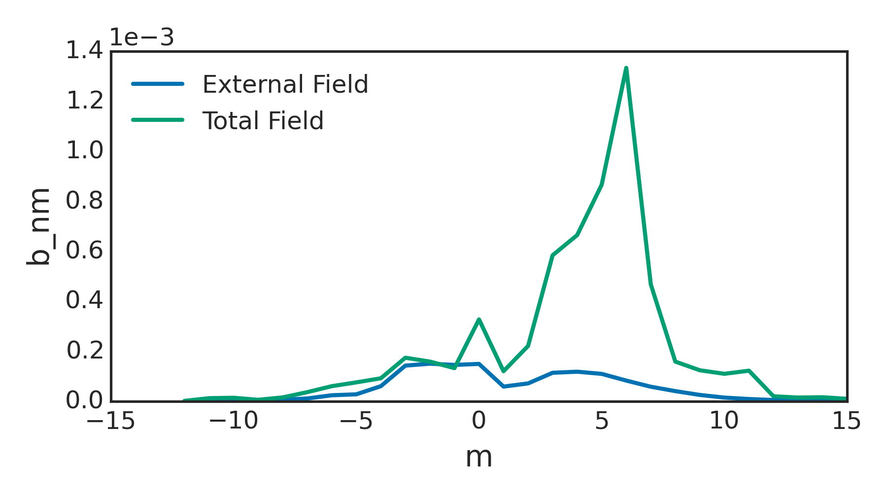

Coordinates
***********

A clear understanding of the input and output coordinate conventions is essential for GPEC. There are up to 3 separate coordinate systems use in the programs within GPEC package. This include,

1. The 'working coordinates' defined by jac_type in equil.in.

2. The 'input coordinates' defined by jac_in, tmag_in, and jsurf_in when applicable.

3. The 'output coordinates' defined by jac_out, tmag_out, and jsurf_out when applicable.

The DCON working coordinate system is used for nearly all internal calculations in the GPEC package, but the external drive may be prescribed in input coordinates (2) and the final perturbed equilibrium results may be converted to output coordinates (3). The working coordinates are magnetic cooridinates. The input and output coordinates may be converted to cylindrical :math:`\phi` using the tmag_in or tmag_out variables.

.. note:: The responsibility of the user is to make sure the GPEC input Jacobian is consistent with the 3D error field input file and the PENTRC input jacobian is consistent with the GPEC output. OMFIT helps sync some of this automatically. However, the user should be aware that each coordinate system has different strengths. Hamada coordinates have the best convergence properties in general, but are poor for the inboard side of the plasma. PEST coordinates are user friendly but poor for outboard resolution. Boozer coordinates tend to find a middle ground between these, with mild convergence and fair resolution throughout the plasma.

The :code:`gpec_control_output_n#` netcdf file gives spectral quantities in the working coordinates (specified in the 'jacobian' attribute). It also provides a J_out matrix. The dot product of this matrix and the b or xi spectra will convert the the output coordinates, reproducing the final table of the gpec_control_n#.out ascii output. *Note that the same transformation cannot be safely made for other weighted quantities*.

Translating to Machine Space
============================

When comparing spectral GPEC outputs to real space quantities or to other codes, it is important to remember

1. GPEC uses a right handed magnetic coordinate system decomposed in :math:`\exp(im\theta-in\phi)`.
2. GPEC effectively uses CCW :math:`\phi` for left-handed (LH) configurations, but CW :math:`\phi` for right-handed (RH) configurations.
3. GPEC always uses upward outboard :math:`\theta`.

.. seealso::

   For a comprehensive reference of all sign conventions (including
   rotation velocity, safety factor, mode number resonance, and code
   interfacing rules), see :doc:`sign_conventions`.

The result of this is that the pitch-aligned field will always be positive m. This convention makes in-house analysis nice and easy. For example, one can *always* plot the m=2 perturbed normal displacement profile and see the resonant surface behavior at q=2. The m=-2 normal displacement will always be nonresonant. This is shown in the figure below from the package DIII-D example, which is a LH plasma.

For another example, the figure below shows a that the positive m fields are magnified for a DIII-D example control surface. We always look here for kink amplification.

The convention does require some awareness from the user when interfacing with real-space quantities and/or other codes though. For example, the user does need to know that the spectrum rotates by :math:`-\phi` if real space coil rotates by :math:`\phi` in a RH configuration.

To facilitate interfacing with other codes that may have different handedness conventions, the helicity is included in the gpec_control_output netcdf file. The helicity is defined as +1 for right handed plasmas in which Bt and Ip are in the same direction, and -1 for left handed plasmas in which Bt and Ip are apposed.

In the real space representation decomposed in :math:`\exp(-in\phi)` with CCW :math:`\phi`, GPEC takes the complex conjugate of the inverse poloidal Fourier transform for RH configurations. This is restoring CCW :math:`\phi` (according to 2), and is done internally before writing function outputs. Note in the full Fourier representation by :math:`\exp(im\theta-in\phi)`, the complex conjugate operation does not simply restore CCW \phi for RH configurations. It will also flip up and down.

Interfacing with SURFMN
=======================

SURFMN is a popular vacuum spectrum code. It calculates the field from experimental coil geometries and/or intrinsic error fields in magnetic coordinates on plasma flux surfaces. SURFMN also uses upward outboard :math:`\theta`. However, it expands in :math:`\exp(-im\theta-in\phi)` and always uses a CCW :math:`\phi`. In SURFMN, the pitch resonant m can flip sign dependending on the sign of Bt and Ip.

As a practical example, interfacing a Fourier representation of the 3D field on a flux surface from GPEC with SURFMN would require using,

.. code-block:: python

   m_surfmn = helicity * m_gpec
   b_surfmn = real(b_m) - i * helicity * imag(b_m).

For LH configurations only the sign of m is flipped (according to 1). For RH configurations, m remains unchanged but the complex conjugate is taken (the combined effect of to 1 & 2).

Interfacing with VACUUM
=======================

Vacuum is the code used in DCON to calculate the vacuum energy matrices, which combine with the plasma energy matrix to describe the full system eigenmodes. The VACUUM code uses CCW :math:`\phi` and downward outboard :math:`\theta`. We thus use the complex conjugate of RH configurations to interface GPEC and VACUUM.

.. _coupling_overlap:

Resonant Coupling and Dominant Mode Overlap
===========================================

Coupling matrices (singcoup_flag) relate area-weighted resonant quantities to the root-area-weighted vacuum field, making their SVD coordinate invariant (Park 2008, Pharr 2026):

.. math::

   \bar{b}^r_i = C_{im} \tilde{b}^x_m, \qquad
   \tilde{b}^x_m = \frac{1}{\sqrt{A^x}} \oint d\theta\, d\phi \, \delta\mathbf{B}^x\cdot\hat{n} \, \sqrt{\mathcal{J}|\nabla\psi|} \, e^{i(n\phi - m\theta)}.

Singular values carry the units of each C; right-singular vectors :math:`\mathbf{v}_j` are unitless.

.. _inputs:

Inputs
******

.. include:: namelists.rst

Outputs
*******

The results of an GPEC run depend on the output flags selected in gpec.in prior to the run. Without getting into the specifics of each output, there are a few important properties any GPEC run that should always be kept in minds. Each GPEC run always returns its results in the form of consistently named .out files in the run-directory. This means that it will overwrite any previous run's results if they are not moved first. Always move any results worth keeping to a separate directory and keep track of which runs used which inputs. Outputs are expensive, so try to limit runs to only output the essential physics of interest each time.

An important property of many GPEC results is their linearity. GPEC calculates results for a single toroidal harmonic. When appropriate, results from multiple runs can simply be added (to obtain a total perturbed field for example). In the same spirit, the amplitude of a plasma response calculated by GPEC is linear with the error-field. Thus, plasma response fields can be multiplier by a constant to simulate changes in a driven 3D error field.

Post-Processing & Visualization
================================

OMFIT
------

The easiest way to visualize and interact with GPEC outputs is through the OMFIT interface. In OMFIT, one can easily navigate the ascii, binary, and netcdf outputs, double-clicking to visualize certain quantities as desired. A number of pre-packaged plotting and post-processing routines are also provided. See the `google doc tutorial <https://docs.google.com/document/d/1qSUjJZYmET8-X08rRGBT6L_9D9fzEN_zCV75OX_ZbZk/edit?usp=sharing>`_ for examples.

PYPEC
------

GPEC installations also come with a stand-alone python package for reading, manipulating, and visualizing the GPEC output. When loading the GPEC module of one of the public installations, this module will be available in your python path. Examples are provided in the :ref:`python documentation <source_documentation>`.

xdraw
-----

The binary GPEC outputs can be viewed using the commandxdraw filenamewhere filename is one of the .bin files created by GPEC (“.bin” excluded). This is a quick way to view results immediately as they are produced. The xdraw tool provides a highly interactive environment that takes keystroke inputs to change plot display options, navigate plots, display single or multiple responses at once, do limited post processing (get a gradient, or ratio), and save figures. For a full list of the command options, enter the xdraw environment and press “k”.

Output Files
============

The GPEC outputs are entirely specified by flags (bool types t or f) set in the gpec_output section of gpec.in. Outputs are written as ASCII tables (ascii_flag), xdraw binary files (bin_flag, bin_2d_flag) and netcdf files (netcdf_flag), and can be grouped into the categories below.

ASCII File Outputs
------------------

A number of the flag options in gpec.in instruct GPEC to output ASCII file data. Some of these outputs are always available. Some, however, require an external 3D field input (data_flag, coil_flag, harmonic_flag) or a single eigenmode (mode_flag). Both groups are listed in detail here.

Outputs Always Available

These GPEC outputs can always be obtained from a euler.bin file output from DCON.

gpec_response_n#.out

    **Flag** resp_flag

    **Info** Energy for DCON eigenmodes and stability indices. Eigenvalues and eigenvectors for vacuum and plasma inductance (virtual casing currents to fields), plasma permeability (external fields to total fields), and plasma reluctance.

gpec_singcoup_matrix_n#.out

    **Flag** singcoup_flag

    **Info** The coupling matrix to resonant fields, coupling matrix to singular currents, and to island half-widths is given for each rational surface within the plasma (q=2, 3, etc) for each surface the real and imaginary coupling constants are given for each poloidal mode number on the control surface.

gpec_singcoup_svd_n#.out

    **Flag** singcoup_flag

    **Info** The SVD singular values (s) and eigen vectors for each coupling matrix in gpec_singcoup_matrix_n#.out. Large s corresponds to large amplification, with the largest (most important mode) listed at the top. The results should be dotted with the unweighted normal field spectrum to give physical meaning.

Outputs Available When Error Field is Provided

These outputs are only available when an external 3D field is provided as an input to GPEC. This means gpec.in must have data_flag (with an infile specified), coil_flag, harmonic_flag, or mode_flag turned on.

gpec_control_n#.out

    **Flag** none (always written with ascii_flag)

    **Info** The Plasma response for an external perturbation on the control surface. This includes the vacuum energy, surface energy, plasma energy, real and imaginary vacuum input \mathbf{B}_{in} and total field on plasma boundary\mathbf{B}_{out}as a function of poloidal mode number.

gpec_singfld_n#.out

    **Flag** singfld_flag

    **Info** The \Psi_{N}, total resonant \mathbf{B} (real and imaginary), singular current (real and imaginary), island half width in units of normalized flux and Chirikov parameter at rational surface inside the plasma. 

    **Flag** singcoup_flag

    **Info** Additional section showing the overlap field (Tesla) and overlap percentage for each eigenmode in the singcoup_svd output. See :ref:`coupling_overlap` for definitions.

gpec_pmodb_n#.out

    **Flag** pmodb_flag

    **Info** Perturbed field strength (real and imaginary, Tesla) for each poloidal mode number at each value of \Psi_{N} output: the Eulerian \delta B (eulb), the Lagrangian \delta B of the displacement with zero \xi^\zeta in the working (jac_type) coordinates (lagb), B\nabla\cdot\xi_\perp (Bdivxprp) and the force-balance form of B\kappa\cdot\xi_\perp (Bkxprp). lagb is not the \xi_\perp-only Lagrangian \delta B; that is -(Bdivxprp+Bkxprp) up to the equilibrium force-balance residual. See :doc:`pmodb_gauge` before using these columns for NTV post processing.

gpec_xbnormal_n#.out

    **Flag** xbnormal_flag

    **Info** The normal displacement (xno), the normal perturbed magnetic field (bno), and the Jacobian-weighted contravariant psi component of the perturbed field J\mathbf{B}\cdot\nabla\psi (bwp) for each poloidal mode number at each value of \Psi_{N} output.

gpec_*rzphi_n#.out

A number of output files have a similar structure. Here the * in the file name is replaced by the appropriate leading letters of the corresponding flag. For example the xrzphi_flag for n=1 creates a gpec_xrzphi_n1.out file. some common properties of these files are:

• real and imaginary components: Output files contain two dimensional data on an \left(r,z\right) grid for a single toroidal harmonic. To translate into three dimensions, perform the transformationB\left(r,z,\phi\right)=B_{real}\left(r,z\right)\cos\left(n\phi\right)+B_{imag}\left(r,z\right)\sin\left(n\phi\right)
 

• l parameter: 1 designates points inside plasma, 0 points in vacuum, -1 points near/on surface (singularity)

    **Flag** eqbrzphi_flag

    **Info** The original equilibrium field on a \left(r,z,\phi\right) grid.

    **Flag** brzphi_flag

    **Info** The \left(r,z,\phi\right)components of the perturbed magnetic fields inside the plasma on the \left(r,z,\phi\right) grid.

    **Flag** xrzphi_flag

    **Info** The displacement on the \left(r,z,\phi\right) grid.

    **Flag** vbrzphi_flag

    **Info** The false perturbed magnetic field in the vacuum region on the \left(r,z,\phi\right) grid calculated using the GPEC boundary surface current composed of both the vacuum component and the plasma response.

    **Flag** pbrzphi_flag (writes gpec_vpbrzphi_n#.out)

    **Info** The true perturbed magnetic field in the vacuum region on the \left(r,z,\phi\right) grid due to the plasma response alone calculated from the plasma response surface condition.

    **Flag** vvbrzphi_flag

    **Info** The false perturbed magnetic field in the vacuum region on the \left(r,z,\phi\right) grid calculated using the GPEC boundary surface current from the external fields alone.

    **Flag** vsbrzphi_flag (with ss_flag(i) selecting surfaces; requires singfld_flag)

    **Info** The vacuum field on the \left(r,z,\phi\right) grid due to the currents on the selected resonant surfaces.

Energy Decomposition Outputs
----------------------------

These outputs reconstruct the ideal plasma energy :math:`\delta W_p` of a single DCON eigenmode on every flux surface and break it into physically distinct terms. They require a pure DCON eigenmode: set mode_flag=t, choose mode (1 is the least stable eigenmode), and keep reg_flag=f and coil_flag=data_flag=harmonic_flag=f. GPEC stops at input if any of the three decomposition flags is set otherwise. The derivations, integrands and the meaning of every printed quantity are documented in :download:`docs/tex/recon/main.tex <tex/recon/main.tex>` (build with pdflatex and bibtex).

Each route prints a summary to the terminal that ends with its :math:`\delta W_p` total, the same total in DCON normalization (dW_p(recon-normalize) and its analogues), the DCON eigenvalue ep(mode) it should reproduce, and the :math:`\psi` range it integrated over beside the DCON range psilow to psilim. In the files below <mode> is the selected mode. recon_out=f keeps only the terminal summary, and recon_int ("spline", the default, or "trapezoid") selects the radial quadrature.

The three routes converge differently with the number of poloidal harmonics. The standard form (standard_form_flag) reproduces the DCON eigenvalue at any truncation, because it evaluates the same Galerkin energy DCON minimizes. The two effective-field forms rely on identities that hold only for the untruncated fields, so they need extra harmonics: in the Soloviev regression example they miss ep(1) by about 20% with the default band and agree to 0.4% with delta_mlow=delta_mhigh=8. The curl check and the identity residual measure this truncation; a PASS on the curl check does not by itself confirm the energy.

gpec_recon_*_sol<mode>.out

    **Flag** effective_field_flag

    **Info** Bernstein effective-field form :math:`2\delta W_p = \int |\mathbf{C}|^2/\mu_0 - \int K \xi_n^2`. integration: radial integrands and running totals. terms: per-(psi,theta) densities of the C and K terms. k, k_sigma_check, shear_fun, curvature: the K kernel and its shear, parallel-current and curvature parts on the (psi,theta,R,Z) grid. cwfun/cwmn, cvfun/cvmn, cv2fun/cv2mn: contravariant and covariant components of C in real and mode space. qvmn: covariant components of the bare perturbed field Q. A summary block is appended to gpec.log.

gpec_recon_cveri_sol<mode>.out

    **Flag** curl_check_flag (with effective_field_flag)

    **Info** Pointwise residual of :math:`(\nabla\times\mathbf{C})\cdot\nabla\psi = 0` on the (psi,theta,R,Z) grid. The terminal and gpec.log report PASS or WARN for the maximum residual relative to the size of the two cancelling terms :math:`(|\partial_\theta C_\zeta|+|\partial_\zeta C_\theta|)/|J|`, together with the absolute maximum and rms.

gpec_recon2_terms_sol<mode>.out, gpec_recon2_integration_sol<mode>.out

    **Flag** standard_form_flag

    **Info** Standard (first) form of the energy with the :math:`\gamma|\nabla\cdot\xi|^2` term omitted: :math:`|Q|^2/\mu_0`, :math:`\mathbf{j}\cdot(\mathbf{Q}\times\xi^*)`, and :math:`(\nabla\cdot\xi)^*(\xi\cdot\nabla p)` densities per surface (terms) and their radial integrals (integration).

gpec_recon3_terms_sol<mode>.out, gpec_recon3_integration_sol<mode>.out

    **Flag** effective_field_terms_flag

    **Info** Split of :math:`|\mathbf{C}|^2 = |\mathbf{Q}|^2 + 2\mathrm{Re}(\mathbf{V}^*\cdot\mathbf{Q}) + |\mathbf{V}|^2` into A, B, Cpar and Iperp, with the identity check epf = A + B + Cpar + Iperp, per surface (terms) and integrated (integration).

Binary File Outputs
-------------------

These files are designed for quick and easy visualization of results using the xdraw command. For more details on using xdraw see the devoted section on this page.

xbnormal.bin

    **Flag** bin_flag

    **Info** The normal displacement and magnetic field as functions of \Psi_{N} for xdraw.

xbnormal_2d.bin

    **Flag** bin_2d_flag

    **Info** Contour profiles of the normal displacement and magnetic field in (R,z) for xdraw.

pflux_re(im)_2d.bin

    **Flag** bin_2d_flag

    **Info** Contour profiles of the real (imaginary) perturbed flux in (R,z) for xdraw.

bnormal_spectrum.bin

    **Flag** bin_2d_flag

    **Info** Surfmn type contours of the normal perturbed magnetic fields as a function of poloidal harmonic number and \Psi_{N}.

solutions.bin, solutions<n>.bin

    **Flag** sol_num (match.in, MATCH)

    **Info** Ideal Euler-Lagrange solution built from DCON eigenfunction sol_num (1 is the most unstable). sol_num=1 writes solutions.bin; sol_num=n>1 writes solutions<n>.bin so several eigenfunctions can be kept side by side.
